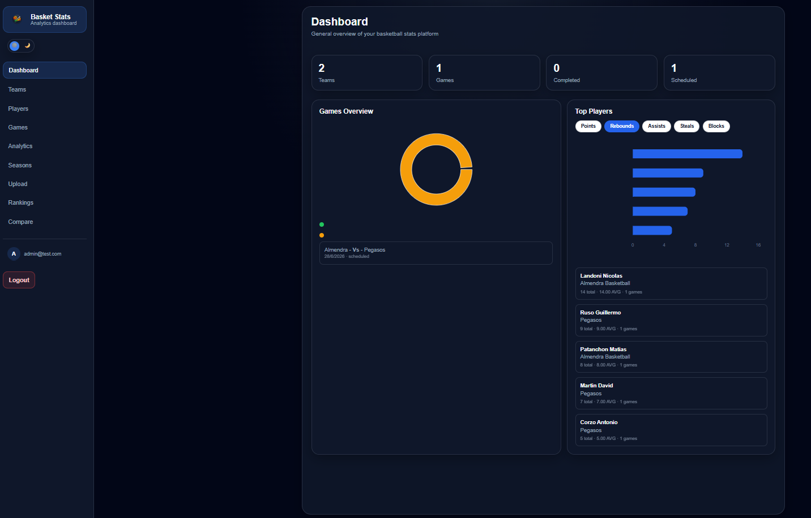
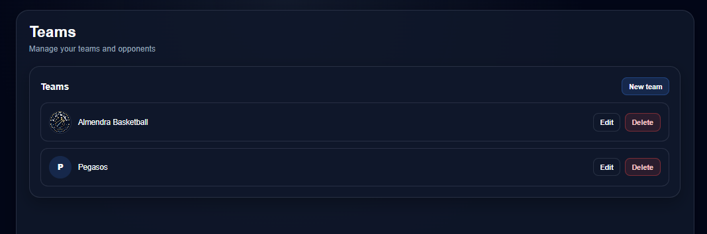
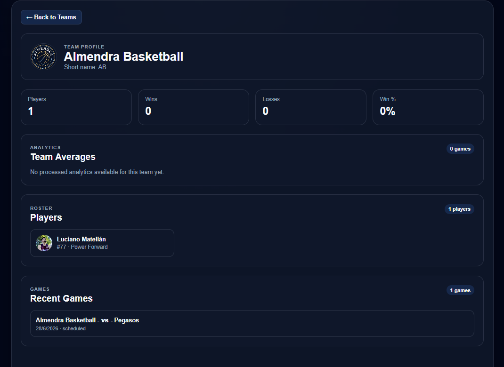
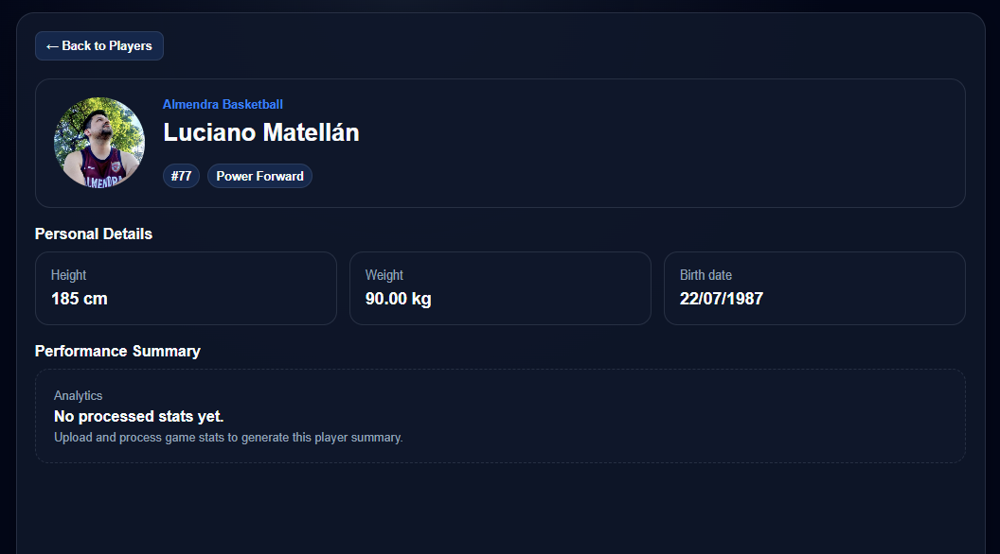
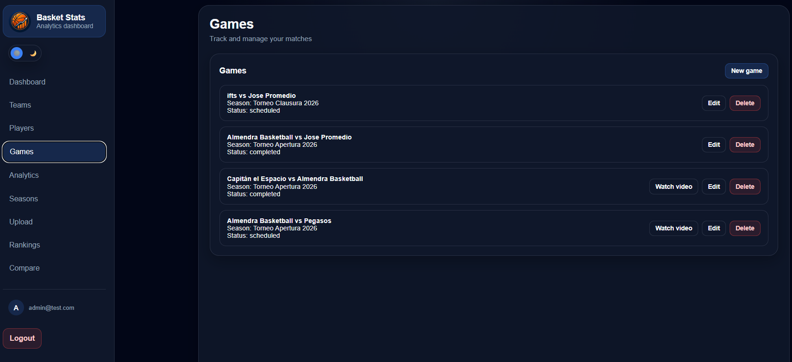
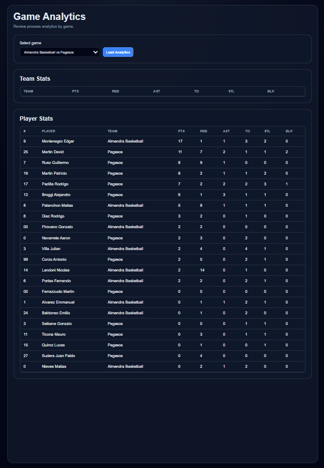
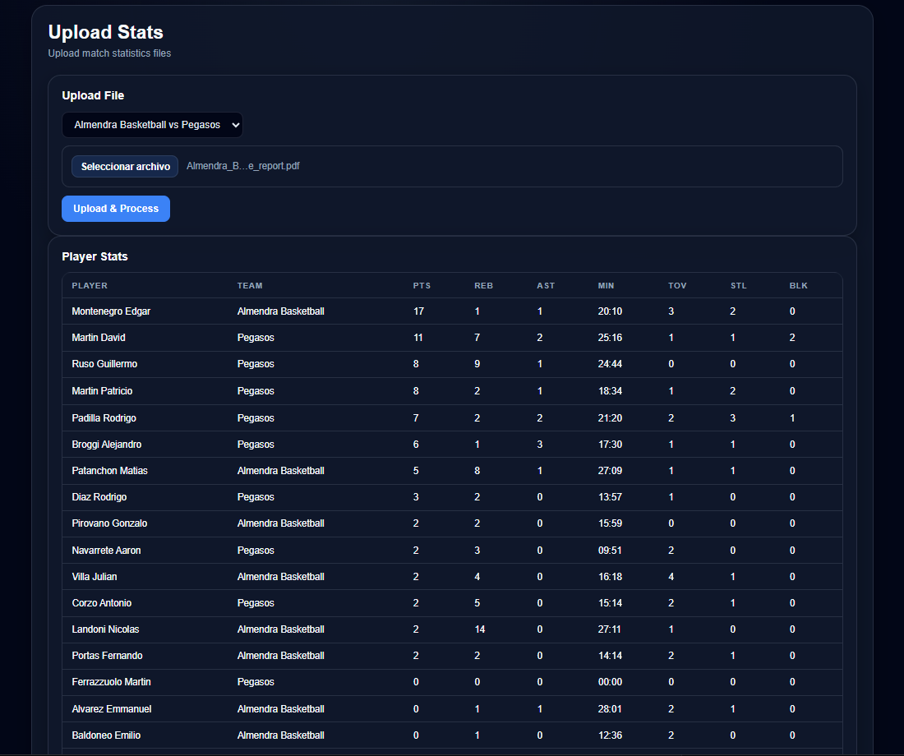
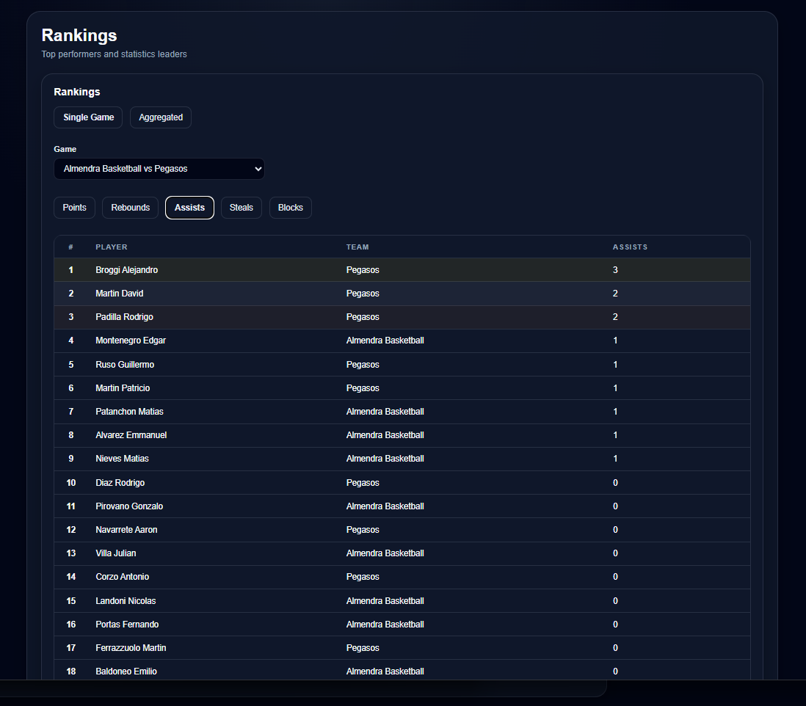
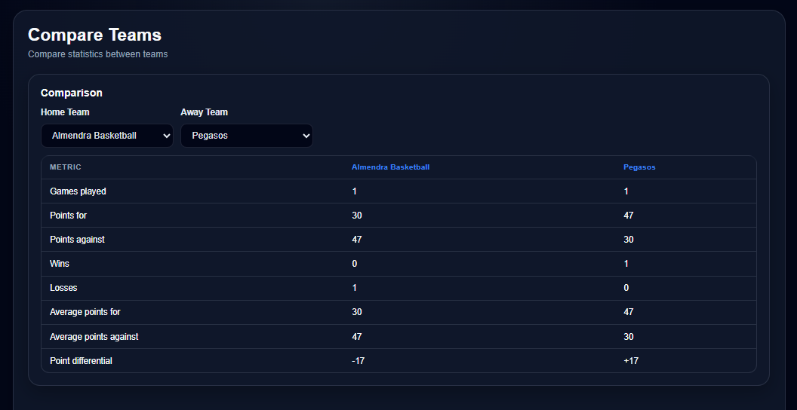

# Basket Stats - Frontend

Frontend application for **Basket Stats**, a basketball statistics and analytics platform developed as part of a cloud-based microservices architecture.

The application provides a responsive web interface for managing teams, players, seasons and games, uploading post-game box-score PDFs, visualising performance analytics, comparing players and teams, and querying statistics through **Swish**, an integrated AI basketball assistant with Generative UI (GenUI) cards.

The frontend is built with **React 19, TypeScript 6 and Vite 8**, containerised with **Docker**, and deployed alongside both backend services on an **Oracle Cloud VPS**:

- **Management API** — responsible for authentication, users, teams, players, seasons and games.
- **Analytics API** — responsible for PDF box-score processing, statistical aggregations, rankings and the AI proxy gateway (`/ai/chat`).

---

## Overview

Basket Stats follows a microservices-based architecture in which the three services run inside Docker containers behind an Nginx reverse proxy on an **Oracle Cloud VPS**.

```text
                  ┌──────────────────────────────┐
                  │       Oracle Cloud VPS       │
                  │     Docker + Nginx Proxy     │
                  └──────────────┬───────────────┘
                                 │
                  ┌──────────────┴───────────────┐
                  │           Frontend           │
                  │     React 19 + TypeScript    │
                  │            Vite 8            │
                  └──────────────┬───────────────┘
                                 │
                  ┌──────────────┴───────────────┐
                  │                              │
                  ▼                              ▼
       ┌─────────────────────┐        ┌─────────────────────┐
       │   Management API    │        │    Analytics API    │
       │                     │        │                     │
       │ Authentication      │        │ PDF box-score ETL   │
       │ Users               │        │ Player & Team stats │
       │ Teams & Players     │        │ Rankings & Trends   │
       │ Seasons & Games     │        │ AI Gateway Proxy    │
       │ PostgreSQL          │        │ PostgreSQL          │
       └─────────────────────┘        └─────────────────────┘
```

The frontend is responsible for:

- User authentication, registration and JWT session handling.
- Protected routes and role-based interface permissions.
- Team, player, season and game management.
- Two-step PDF box-score statistics upload and processing.
- Interactive statistical visualisations and game-level analytics.
- Multi-player and team statistical comparisons.
- Conversational basketball analytics through Swish AI Assistant.
- Interactive Generative UI cards.
- Persistent light and dark themes.

## Features

### Authentication & Role-Based Access

- User registration and login.
- JWT-based authentication.
- Token and user information stored in browser `localStorage`.
- Protected routes through `ProtectedRoute`.
- Automatic redirection to `/login` when unauthenticated.
- Role-based interface permissions.

Authentication data is stored using the following localStorage keys:

```text
basket_stats_token
basket_stats_user
```

#### User Roles and Permissions

The frontend implements role-based permissions through:

`src/auth/permissions.ts`

| Role | Teams | Players | Games | Seasons | Upload Stats |
|---|---|---|---|---|---|
| Admin | Manage | Manage | Manage | Manage | Yes |
| Coach | Manage | Manage | View | View | Yes |
| DT | Manage | Manage | View | View | Yes |
| Player | View | View | View | View | No |

The `dt` role is normalised to the `coach` permission level.

The main permission helpers include:

```ts
canManageTeams()
canManagePlayers()
canManageGames()
canManageSeasons()
canUploadStats()
```

### Swish AI Assistant (Generative UI)

Basket Stats integrates **Swish**, a conversational AI basketball assistant available through a floating chat widget.

The assistant connects to the Analytics API AI gateway through:

- `ChatWidget.tsx`
- `aiGatewayService.ts`
- `aiTools.ts`

The AI gateway communicates with OpenRouter through:

```text
${VITE_ANALYTICS_API_URL}/ai/chat
```

#### Main Capabilities

- **Bilingual Support:** Automatically detects and responds in Spanish or British English.
- **Deterministic Tool Execution:** Uses application tools to retrieve real basketball data.
- **Search Resilience:** Supports accent and case normalisation, reversed player-name lookup (First Last / Last First), homonym disambiguation and Levenshtein distance-based suggestions.
- **Contextual Responses:** Answers questions about games, teams, players, statistics and comparisons.

#### Supported Tools

| Tool | Description |
|---|---|
| `getMatchSummary` | Retrieves a game summary. |
| `getGames` | Retrieves available games. |
| `getTeams` | Retrieves teams. |
| `getTeamStats` | Retrieves team statistics. |
| `getTopScorers` | Retrieves top scorers. |
| `getPlayerSummary` | Retrieves an individual player summary. |
| `comparePlayers` | Compares player statistics. |

#### Interactive GenUI Cards

Swish can generate interactive cards containing basketball information and contextual navigation.

**MatchCard**

- Game scoreboard.
- Team badges with initials fallback.
- Top five scorers.
- Direct navigation to game analytics (`/analytics?gameId=...`).

**PlayerCard**

- Player photo or initials.
- Jersey number.
- Team badge.
- Per-game averages: PTS, REB, AST and STL.
- Direct navigation to the player profile (`/players/:id`).

**CompareCard**

- Side-by-side player comparison.
- Dynamic comparison selector:
    - Overall Averages.
    - Head-to-Head Average.
    - Specific match.
- `DNP · No jugó` badge when a player did not participate in a game.
- Contextual navigation to `/analytics` or `/compare`.

### Player & Team Comparison (`/compare`)

The comparison section provides two modes.

**Player Comparison Mode**

- Compare between 2 and 4 players simultaneously.
- Filter players by team or specific match.
- Highlight the best values in each statistical category.
- Display `DNP · No jugó` badges when applicable.
- Synchronise comparison state with URL query parameters.

Example:

```text
/compare?mode=players&players=id1,id2
```

**Team Comparison Mode**

- Compare aggregated team averages.
- Statistical categories include:
    - Points (PTS).
    - Rebounds (REB).
    - Assists (AST).
    - Steals (STL).
    - Blocks (BLK).
    - Turnovers (TOV).
- Display team crests with initials fallback.

### Game Analytics (`/analytics`)

The game analytics section provides detailed statistical information for individual matches.

Features include:

- Player statistics by game.
- Team statistics by game.
- Individual player filters.
- URL synchronisation through `gameId` and `playerIds` search parameters.
- A **View Full Roster** action to clear player filters and restore the complete match roster.

### Team Management

- View, create, edit and delete teams according to role permissions.
- Individual team profiles.
- Team logos and information.
- Team statistical summaries.

### Player Management

- View, create, edit and delete players according to role permissions.
- Player profiles.
- Player photos.
- Jersey numbers and positions.
- Physical attributes.
- Individual statistical summaries.

### Season Management

- View seasons.
- Create, edit and delete seasons according to role permissions.
- Associate seasons with teams.

### Game Management

- View scheduled and completed games.
- Create, edit and delete games according to role permissions.
- Register game results.
- Display game status.
- Access individual game analytics.

### Post-Game PDF Statistics Upload (`/upload-stats`)

The frontend provides a two-step workflow connected to the Analytics API:

1. Upload the official post-game box-score PDF file.
2. Trigger parsing and statistical extraction into the analytics database.

The Analytics API processes the uploaded document and makes the resulting statistical data available for rankings, player summaries and team analytics.

### Dashboard & Rankings

The dashboard provides an overview of relevant application data through:

- Summary KPI cards.
- Game status distribution charts.
- Top scorers.
- Recent games.
- Statistical visualisations using Recharts.

The rankings section provides aggregated player rankings by statistical category:

- Points.
- Rebounds.
- Assists.
- Steals.
- Blocks.

### Themes

The application supports:

- Light mode.
- Dark mode.

The selected theme is persisted locally in the browser.

---

## Application Structure

The main frontend source structure is organised as follows:

```text
src/
├── assets/
│   ├── readme/
│   │   └── images/
│   └── logo.png
│
├── auth/
│   └── permissions.ts
│
├── components/
│   ├── analytics/
│   ├── common/
│   │   └── ChatWidget.tsx
│   ├── games/
│   ├── helpers/
│   ├── hooks/
│   ├── layout/
│   ├── genui/
│   │   ├── CompareCard.tsx
│   │   ├── MatchCard.tsx
│   │   └── PlayerCard.tsx
│   ├── pages/
│   │   ├── compare/
│   │   ├── dashboard/
│   │   ├── games/
│   │   ├── login/
│   │   ├── players/
│   │   ├── rankings/
│   │   ├── register/
│   │   ├── seasons/
│   │   ├── teams/
│   │   └── uploads/
│   └── teams/
│
├── routes/
│   ├── AppRouter.tsx
│   └── ProtectedRoute.tsx
│
├── services/
│   ├── aiGatewayService.ts
│   ├── aiTools.ts
│   ├── api.ts
│   ├── authApi.ts
│   └── teamAnalytics.ts
│
├── types/
│   ├── ai.ts
│   ├── analytics.ts
│   ├── chart.ts
│   ├── chat.ts
│   ├── compare.ts
│   ├── confirmModal.ts
│   ├── filter.ts
│   ├── game.ts
│   ├── player.ts
│   ├── ranking.ts
│   ├── season.ts
│   └── team.ts
│
├── App.tsx
├── index.css
└── main.tsx
```

## Routing

Application routes are defined in:

`src/routes/AppRouter.tsx`

### Public Routes

```text
/login
/register
```

### Protected Routes

```text
/
/dashboard
/teams
/teams/:id
/players
/players/:id
/games
/upload-stats
/rankings
/compare
/seasons
/analytics
```

The root route (`/`) redirects to `/dashboard`.

Protected routes are handled through the `ProtectedRoute` component.

## API Integration

The frontend communicates with two independent backend services.

### Management API

Responsible for:

- User authentication and registration.
- User management.
- Team CRUD operations.
- Player CRUD operations.
- Season CRUD operations.
- Game CRUD operations.
- Game result updates.

### Analytics API

Responsible for:

- PDF uploads.
- Box-score processing.
- Player statistics.
- Team statistics.
- Player rankings.
- Aggregated rankings.
- Player summaries.
- Game analytics.
- AI gateway proxy (`/ai/chat`).

### Main Integration Services

| File | Responsibility |
|---|---|
| `api.ts` | General API communication. |
| `authApi.ts` | Authentication requests. |
| `teamAnalytics.ts` | Team analytics aggregation. |
| `aiGatewayService.ts` | Communication with the AI gateway. |
| `aiTools.ts` | Deterministic AI tool definitions and execution. |

## Environment Variables

Create a `.env` file in the project root.

### Local Development

```dotenv
VITE_MANAGEMENT_API_URL=http://localhost:8080
VITE_ANALYTICS_API_URL=http://localhost:8081
```

### Production (Oracle Cloud VPS)

```dotenv
VITE_MANAGEMENT_API_URL=https://147.15.10.181.nip.io/management
VITE_ANALYTICS_API_URL=https://147.15.10.181.nip.io/analytics
```

These variables define the URLs used by the frontend to communicate with the backend services.

Environment-specific configuration should be managed through environment variables rather than hardcoded into the application.

**Note:** Vite environment variables prefixed with `VITE_` are exposed to the client-side application. Do not store secrets or private credentials in these variables.

## Technologies

### Core

- React `^19.2.4`
- React DOM `^19.2.4`
- TypeScript `~6.0.2`
- Vite `^8.0.4`

### Routing

- React Router DOM `^7.14.1`

### Data Visualisation & Content

- Recharts `^3.9.0`
- React Markdown `^10.1.0`

### AI Integration

- OpenRouter.
- Custom AI gateway integration.
- Deterministic tool execution.
- Generative UI (GenUI).

### Styling

- Custom CSS.
- CSS variables.
- Light and dark theme support.

### Development Dependencies

- ESLint `^9.39.4`
- TypeScript ESLint `^8.58.0`
- ESLint React Hooks plugin `^7.0.1`
- ESLint React Refresh plugin `^0.5.2`
- Vite React plugin `^6.0.1`
- Node.js types `^24.12.2`
- React types `^19.2.14`
- React DOM types `^19.2.3`
- Globals `^17.4.0`

### Containerisation & Infrastructure

- Docker.
- Docker Compose.
- Nginx reverse proxy.
- Oracle Cloud VPS.

---

## Requirements

Before installing the project, make sure the following tools are available:

- Node.js `20.19+` or `22.12+`.
- npm.
- Git.

Docker and Docker Compose are required for the containerised deployment environment.

## Installation

Clone the repository and install the project dependencies:

```bash
npm install
```

Create a `.env` file in the project root with the required backend URLs.

```dotenv
VITE_MANAGEMENT_API_URL=<management-api-url>
VITE_ANALYTICS_API_URL=<analytics-api-url>
```

Start the development server:

```bash
npm run dev
```

The application will be available at the local development URL provided by Vite.

## Available Scripts

### Development

```bash
npm run dev
```

Starts the Vite development server.

### Build

```bash
npm run build
```

Runs the TypeScript project build (`tsc -b`) and generates the production bundle using Vite (`vite build`).

### Lint

```bash
npm run lint
```

Runs ESLint across the project.

### Preview

```bash
npm run preview
```

Serves the production build locally for preview.

---

## Deployment

### Production Infrastructure

The three application services are containerised with Docker Compose and deployed on an **Oracle Cloud VPS**.

The infrastructure uses Nginx as an HTTPS reverse proxy to route incoming requests to the corresponding services.

| Service | Route | Infrastructure |
|---|---|---|
| Frontend | `/` | Oracle Cloud VPS (Docker) |
| Management API | `/management` | Oracle Cloud VPS (Docker) |
| Analytics API | `/analytics` | Oracle Cloud VPS (Docker) |

Production base URL:

```text
https://147.15.10.181.nip.io
```

### Architecture

```text
                 Internet
                    │
                    ▼
              Nginx Reverse Proxy
                    │
             HTTPS / Routing
                    │
       ┌────────────┼────────────┐
       │            │            │
       ▼            ▼            ▼
   Frontend    Management    Analytics
   Container      API          API
                 Container    Container
                    │            │
                    ▼            ▼
               PostgreSQL    PostgreSQL
```

Docker Compose manages the application containers and their deployment configuration.

---

## Screenshots

### Dashboard



### Teams



### Team Profile



### Players



### Games



### Game Analytics



### Upload Statistics



### Rankings



### Team & Player Comparison



---

## Project Documentation

Additional documentation and UML sequence diagrams are available in the `docs/` directory.

```text
docs/
├── diagrams/
└── final-delivery.md
```

The available sequence diagrams cover application flows such as:

- Login.
- Registration.
- Teams.
- Players.
- Games.
- Rankings.
- Team comparison.
- Statistics upload and processing.

## Related Repositories

Basket Stats is composed of three independent repositories:

| Repository | Responsibility |
|---|---|
| `basket-stats-frontend` | User interface, visualisations and Swish AI GenUI client. |
| `management-api-node` | Authentication, users, teams, players, seasons and games API. |
| `analytics-api-node` | PDF box-score parsing, statistical aggregations, rankings and AI proxy. |

The frontend communicates with both backend services through HTTP APIs.

---

**Basket Stats** — Basketball statistics and analytics platform.